# AWS Emulator + NestJS Telemetry Lab

[GitHub repository](https://github.com/mickychog/aws-emulator-telemetry-lab) · [Español](docs/README.es.md) · [Backend reference](backend/README.md)

A local telemetry API built with NestJS, TypeScript and AWS SDK for JavaScript v3. It stores the latest agent status in DynamoDB, saves a JSON history in S3, and publishes an SQS alert when CPU usage reaches **80% or higher**.

The lab uses AWS Emulator **1.0.551** at **`https://127.0.0.1:9297`**, in `us-east-1`, with emulated account `000000000000`. This repository contains a learning exercise, not a production deployment.

## Architecture

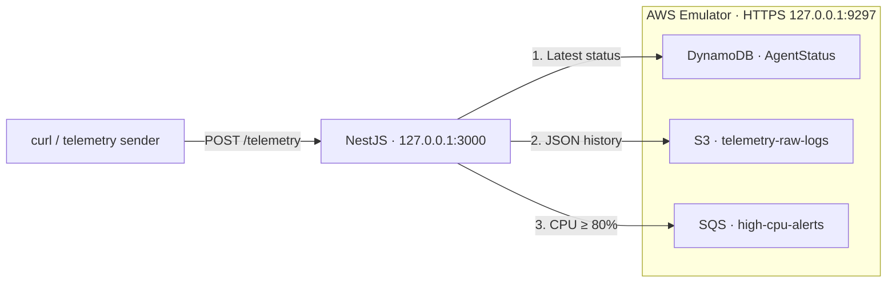

| Resource | Name | Behavior |
| --- | --- | --- |
| S3 bucket | `telemetry-raw-logs` | One object per accepted measurement: `logs/<agentId>/<uuid>.json` |
| DynamoDB table | `AgentStatus` | String partition key `agentId`; each write replaces that agent's item |
| SQS queue | `high-cpu-alerts` | A `HIGH_CPU_USAGE` message for each measurement with `cpuUsage >= 80` |

The service writes sequentially: DynamoDB → S3 → optional SQS. The response is returned after those operations complete. There is no agent collector or queue consumer in this repository; `curl` supplies example measurements.

## Verified environment and results

Recorded on **2026-11-21** in [environment.txt](docs/evidence/environment.txt):

| Component | Recorded version |
| --- | --- |
| OS | Linux Mint 22.3, x86_64 |
| Node.js / npm | 24.22.1 / 11.19.1 |
| AWS CLI | 2.36.29 |
| AWS Emulator | 1.0.551, release 2026.11.21 |
| TypeScript | 6.0.3 |
| Vitest | 4.1.12, shown in the test output |

The emulator build identifies commit `cc3a33fddf7ef0e48566ba31c217eb506b3c5f8f`. Versions describe this lab's environment; they are not a claim about the latest available releases.

| Check | Verified result | Scope |
| --- | --- | --- |
| Unit tests | **2 passed** | Controller delegation and returned alert flag; `AppService` mocked |
| HTTP E2E tests | **3 passed** | Valid POST, CPU above 100, missing `agentId`; `AppService` mocked |
| Build | **Passed** | `npm run build` |
| Manual emulator integration | Captured in images 07–12 | Normal/critical telemetry, storage, SQS alert and invalid input |
| Current emulator read checks | Passed during documentation review | HTTPS health 200, local STS account, bucket exists, table ACTIVE with `agentId` key, queue URL |

The tests and build were rerun successfully during this documentation review. The manual POST/storage/message workflow is supported by the existing screenshots; it was **not rerun** during that review. Neither automated suite tests the AWS SDK calls or the service's CPU threshold implementation against an emulator.

## Repository layout

```text
.
├── README.md
├── backend/
│   ├── .env.example
│   ├── README.md
│   ├── src/                   # Controller, service and DTO
│   ├── test/                  # HTTP E2E tests
│   └── vitest.config*.ts
├── scripts/
│   ├── use-emulator.sh        # Source into each client/backend shell
│   └── init-aws.sh            # Create/check the three local resources
└── docs/
    ├── README.es.md
    ├── evidence/environment.txt
    └── images/               # 14 original screenshots
```

## Setup on Linux Mint 22.3

The following are reproduction instructions. Package installation and a fresh `npm ci` were not rerun during the documentation review. An installed Node.js matching the recorded version and AWS CLI v2 are prerequisites; see the official [Node.js downloads](https://nodejs.org/en/download) and [AWS CLI installation guide](https://docs.aws.amazon.com/cli/latest/userguide/getting-started-install.html).

### 1. Install the Linux prerequisites and emulator

For the x86_64/amd64 lab machine:

```bash
sudo apt-get update
sudo apt-get install -y git curl ca-certificates
mkdir -p ~/Downloads/aws-emulator-lab
cd ~/Downloads/aws-emulator-lab
curl -fSLo aws-emulator.deb \
  https://downloads.aws.com/aws-emulator/packages/aws-emulator/LTS/aws-emulator_1.0.551-1_amd64.deb
sudo apt-get install -y ./aws-emulator.deb
aws-emulator --version
node --version
npm --version
aws --version
```

This URL pins the recorded emulator build. AWS documents the [Linux installation and package signature verification](https://docs.aws.amazon.com/emulator/latest/userguide/getting-started-linux.html) and [version-specific package URLs](https://docs.aws.amazon.com/emulator/latest/userguide/versioning.html). Review version changes before upgrading; record your own results if you use a different build. These commands install software but do not start the backend.

### 2. Start the emulator — terminal A

```bash
aws-emulator
```

Keep this terminal open. The startup log should show `https://127.0.0.1:9297` and the generated configuration under `~/.aws/emulator/9297/`. Authentication stays enabled. The command also supports `--telemetry off` to disable emulator usage/error telemetry for that run, as documented in the [command reference](https://docs.aws.amazon.com/emulator/latest/userguide/cli-reference.html). That telemetry is separate from the measurements sent to this API.

### 3. Configure the shell and resources — terminal B

Clone the repository once (skip this if you already have a checkout):

```bash
mkdir -p ~/Proyectos
git clone https://github.com/mickychog/aws-emulator-telemetry-lab.git ~/Proyectos/aws-emulator-telemetry-lab
```

The commands below use that directory; adjust it if your checkout lives elsewhere.

```bash
cd ~/Proyectos/aws-emulator-telemetry-lab
source scripts/use-emulator.sh
curl --fail --silent --show-error --cacert "$AWS_CA_BUNDLE" \
  https://127.0.0.1:9297/__admin/health
aws sts get-caller-identity
bash scripts/init-aws.sh
```

Expected: health HTTP 200 (`ok`), STS account **`000000000000`**, and all three resources available. If a different account appears, stop and check the environment before continuing.

`use-emulator.sh` exports these settings for the current shell:

| Setting | Value/purpose |
| --- | --- |
| `AWS_ENDPOINT_URL` | `https://127.0.0.1:9297` |
| `AWS_SHARED_CREDENTIALS_FILE` | `$HOME/.aws/emulator/9297/emulator_credentials` |
| `AWS_CONFIG_FILE` | `$HOME/.aws/emulator/9297/config` |
| `AWS_CA_BUNDLE`, `NODE_EXTRA_CA_CERTS` | `$HOME/.aws/emulator/9297/ca.pem`; CLI and Node trust |
| `AWS_REGION`, `AWS_DEFAULT_REGION` | `us-east-1` |
| `AWS_EC2_METADATA_DISABLED` | `true` |
| `AWS_DISABLE_HOST_PREFIX_INJECTION` | `true` for supported CLI operations |
| `AWS_PAGER` | Empty; avoids the CLI pager |

It unsets inherited `AWS_ACCESS_KEY_ID`, `AWS_SECRET_ACCESS_KEY`, `AWS_SESSION_TOKEN` and `AWS_PROFILE`. Use **`source`**, not `bash`, for this script so its exports remain in your shell. Source it separately in every terminal that runs AWS commands or the backend. The files belong to your own emulator run; do not copy someone else's credentials. See [SDK endpoint and certificate configuration](https://docs.aws.amazon.com/emulator/latest/userguide/point-sdk-to-emulator.html).

`init-aws.sh` refuses a different endpoint or STS account. It reuses an existing bucket, requests the named queue, creates the table if needed with `PAY_PER_REQUEST`, and checks that the table is ACTIVE and its first key is `agentId`. It can be rerun for this expected setup, but it does not repair arbitrary resource schema differences.

### 4. Install and start the backend — terminal B

```bash
cd ~/Proyectos/aws-emulator-telemetry-lab
source scripts/use-emulator.sh
cd backend
npm ci
# Create the local file only if it does not already exist:
if [ ! -f .env ]; then cp .env.example .env; fi
npm run start:dev
```

The local `.env` must contain:

```dotenv
S3_BUCKET_NAME=telemetry-raw-logs
DYNAMODB_TABLE_NAME=AgentStatus
SQS_QUEUE_NAME=high-cpu-alerts
```

NestJS reads `.env` from the backend working directory. The API binds explicitly to **`http://127.0.0.1:3000`**; the current code does not read `PORT`. The AWS endpoint is HTTPS, while this loopback API uses HTTP. The service refuses startup unless `AWS_ENDPOINT_URL` exactly matches the local emulator URL. S3 uses `forcePathStyle: true`; SQS uses `useQueueUrlAsEndpoint: false` to retain the configured endpoint.

## Exercise the API — terminal C

```bash
cd ~/Proyectos/aws-emulator-telemetry-lab
source scripts/use-emulator.sh
```

### Normal telemetry

```bash
curl -i -sS -X POST http://127.0.0.1:3000/telemetry \
  -H 'Content-Type: application/json' \
  -d '{"agentId":"node-01","hostname":"linux-mint-lab","cpuUsage":35.5,"memoryUsage":48.2}'
```

Expected: **201 Created** and `alertTriggered: false`. Response shape below is illustrative; timestamps and object UUIDs are generated per request.

```json
{
  "status": "processed",
  "agentId": "node-01",
  "timestamp": "<generated ISO timestamp>",
  "s3Key": "logs/node-01/<generated UUID>.json",
  "alertTriggered": false
}
```

### High CPU telemetry

```bash
curl -i -sS -X POST http://127.0.0.1:3000/telemetry \
  -H 'Content-Type: application/json' \
  -d '{"agentId":"node-02","hostname":"server-test","cpuUsage":92.5,"memoryUsage":76.3}'
```

Expected: **201**, `alertTriggered: true`, latest status in DynamoDB, a new S3 object and an SQS JSON message containing `type`, `agentId`, `cpuUsage` and `timestamp`. The type is `HIGH_CPU_USAGE`. Memory usage is stored but does not trigger an alert. Repeated high CPU requests generate repeated alerts.

### Invalid input

```bash
curl -i -sS -X POST http://127.0.0.1:3000/telemetry \
  -H 'Content-Type: application/json' \
  -d '{"agentId":"node-03","hostname":"invalid-test","cpuUsage":150,"memoryUsage":40}'
```

Expected: **400 Bad Request**. Both usage fields must be JSON numbers between 0 and 100; `agentId` and `hostname` must be nonempty strings. All four fields are required. The global `ValidationPipe` rejects extra fields (`whitelist`, `forbidNonWhitelisted`, `transform`). Validation rejects this request before calling the service. There is no `GET /` sample route.

### Inspect local storage and alerts

Use a shell configured with `source scripts/use-emulator.sh` from the repository root:

```bash
aws dynamodb get-item --table-name AgentStatus \
  --key '{"agentId":{"S":"node-01"}}'
aws s3 ls s3://telemetry-raw-logs/logs/node-01/
aws dynamodb get-item --table-name AgentStatus \
  --key '{"agentId":{"S":"node-02"}}'
aws s3 ls s3://telemetry-raw-logs/logs/node-02/
QUEUE_URL=$(aws sqs get-queue-url --queue-name high-cpu-alerts \
  --query QueueUrl --output text)
aws sqs receive-message --endpoint-url "$AWS_ENDPOINT_URL" \
  --queue-url "$QUEUE_URL" --max-number-of-messages 10 --wait-time-seconds 2
aws sqs get-queue-attributes --endpoint-url "$AWS_ENDPOINT_URL" \
  --queue-url "$QUEUE_URL" \
  --attribute-names ApproximateNumberOfMessages ApproximateNumberOfMessagesNotVisible
```

A returned queue URL can contain `sqs.us-east-1.amazonaws.com/000000000000/...`; retain the local endpoint configuration. The backend explicitly ignores the queue URL as a transport endpoint. Receiving a message temporarily changes its visibility; it does not delete it. A visible count of zero after a receive does not prove the queue is empty or the message was deleted. No consumer or automatic acknowledgement is implemented here.

## Run automated checks

From `backend/`, with dependencies installed (the emulator is not required for these mocked tests):

```bash
npx vitest run --config vitest.config.ts
npx vitest run --config vitest.config.e2e.ts
npm run build
```

Equivalent test shortcuts are `npm test` and `npm run test:e2e`. Expected counts: **2 unit + 3 HTTP E2E**. The build emits files under `dist/`. Coverage, service failure handling, CPU boundary behavior, load tests, and real AWS integration are not established by these five tests.

## Evidence gallery

The **14 original screenshots below are displayed directly from this repository**. They document the recorded lab run, rather than a newly repeated integration run. Numbering intentionally skips 13. The alternate `04-emulated-account1.png` is excluded from Git.

### Environment, emulator, identity and resources (01–06)

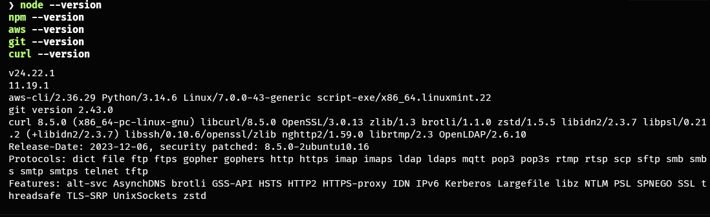

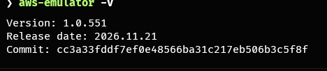

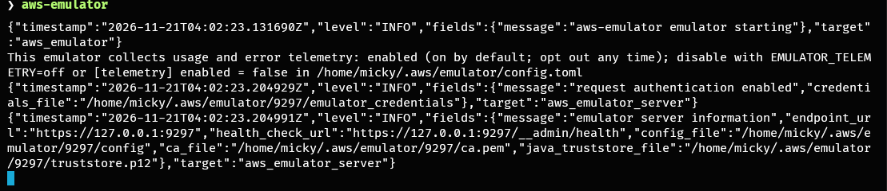

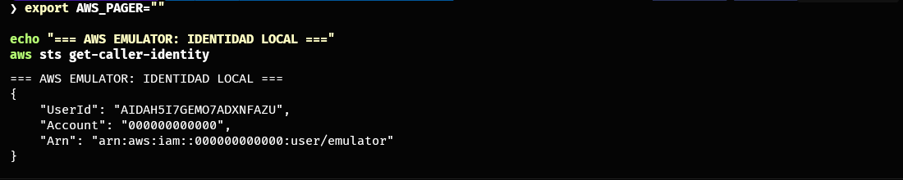

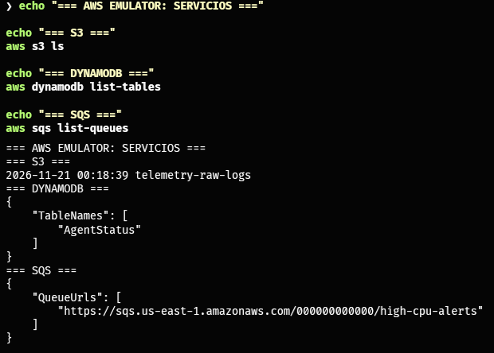

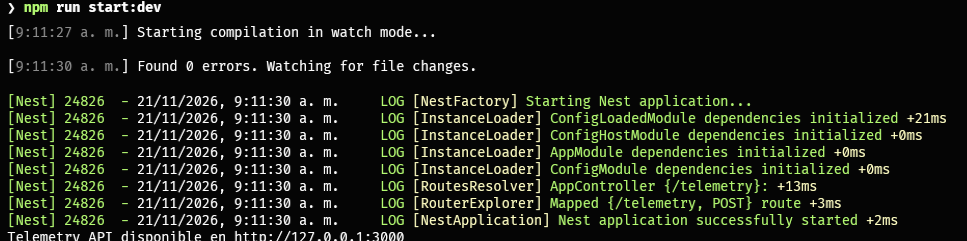

### Manual API, storage, alert and validation checks (07–12)

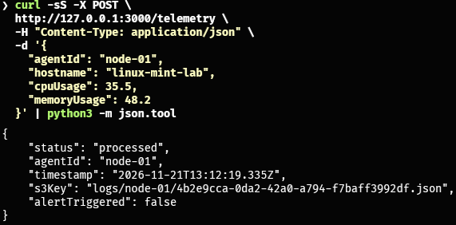

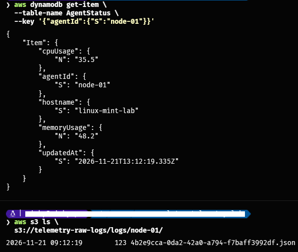

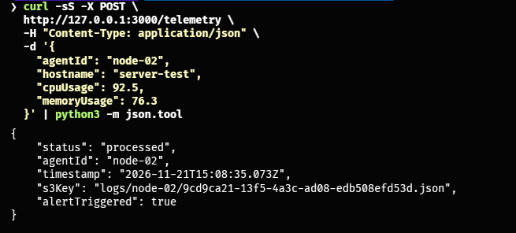

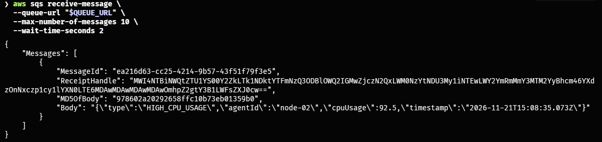

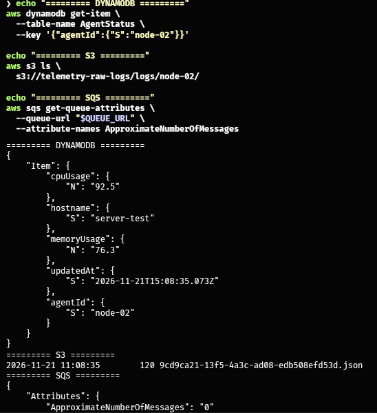

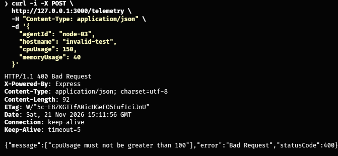

### Automated checks (14–15)

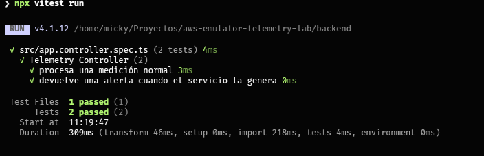

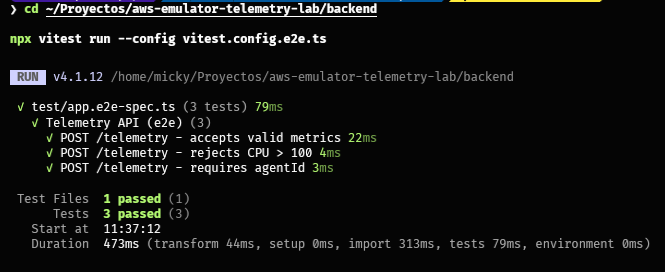

## Security and limitations

- Keep the emulator and API on loopback. Retain authentication and trust the generated CA; do not use `--no-verify-ssl`, `curl -k` or `NODE_TLS_REJECT_UNAUTHORIZED=0`.
- Use local emulator credentials only. `.env`, `.aws/`, certificates, `node_modules/`, `dist/` and coverage are ignored. Git ignore rules do not remove previously tracked files or hide secrets embedded in screenshots. The captures include local paths and emulated identifiers; review them before publishing.
- The exact endpoint/account guards reduce accidental cloud use; they are not a security boundary. Audit shell overrides and AWS configuration before running CLI commands.
- Emulation cannot establish production compatibility or IAM policy correctness. Use one account/region for this lab; see the official [emulator limitations](https://docs.aws.amazon.com/emulator/latest/userguide/what-is-service.html#what-is-service-limitations).
- The backend has no authentication, authorization, rate limiting, durable retry workflow or idempotency key. Writes across the three services are not atomic: a failure can leave earlier writes in place, and a retry can create additional S3 objects or SQS messages.
- Selected connection-error messages map to HTTP 503; other processing errors map to HTTP 500. These failure paths have not been covered by the current tests.
- There is no metrics collector, dashboard, alert consumer, deployment configuration or CI pipeline in this repository. `@nestjs/observe` is listed as a dependency, but `AppModule` does not register `ObserveModule`; this lab does not claim Observe instrumentation.
- Emulator resources are held in memory and lost when it stops. Restarting requires resource initialization again, and backend restart to load the new certificate. See [emulator lifecycle](https://docs.aws.amazon.com/emulator/latest/userguide/getting-started-linux.html).

## Troubleshooting and shutdown

| Symptom | Action |
| --- | --- |
| Endpoint safety error at startup | Source `scripts/use-emulator.sh` in the shell that starts NestJS |
| Certificate error | Confirm the emulator is running, source the script and restart Node so it loads `NODE_EXTRA_CA_CERTS` |
| Missing credentials or access denied | Check the generated files exist for the current run; source the script to clear inherited cloud credentials |
| Missing bucket, table or queue | Run `bash scripts/init-aws.sh` from the configured repository shell |
| `.env` values missing | Create `backend/.env` from the example and launch from `backend/` |
| Port 9297/3000 already occupied | Check `ss -ltnp`; use the intended existing process or stop your previous instance. Changing the emulator port also requires code/script changes because this lab pins 9297 |
| No SQS message returned | Send a high CPU sample; check visible/in-flight counts and any prior receive operation |

Stop NestJS and then the emulator with Ctrl+C in their respective terminals. Open a fresh shell before switching back to real AWS work so this lab's environment settings do not carry over.

## Contribute and publish updates

From the repository root, inspect the changes and stage the documentation explicitly:

```bash
git add README.md docs/README.es.md backend/README.md
git diff --check
git diff --cached --check
git status --short
git diff --cached --stat
git diff --cached --name-only
```

Review the staged source, configuration and screenshots. Verify private files are absent. The canonical repository is [mickychog/aws-emulator-telemetry-lab](https://github.com/mickychog/aws-emulator-telemetry-lab), with default branch `main`.

When ready, commit your documentation changes:

```bash
git commit -m "docs: document AWS Emulator telemetry lab in English and Spanish"
```

A clone already has `origin` configured. Inspect `git remote -v` before pushing. Maintainers with write access can publish using `git push -u origin main`; other contributors should use their own fork and a pull request. For the original local checkout, the SSH remote is `git@github.com:mickychog/aws-emulator-telemetry-lab.git`. Check both language links and image rendering on GitHub after pushing.

The repository currently has no project license file and `backend/package.json` declares `UNLICENSED`. Choose a license before advertising reuse rights. For an AWS Builder Center or DEV Community article, link the published repository, keep the tested versions and scope explicit, and distinguish local manual evidence from mocked automated tests. Article publication is a separate step.
