# Laboratorio de telemetría con AWS Emulator + NestJS

[Repositorio en GitHub](https://github.com/mickychog/aws-emulator-telemetry-lab) · [English](../README.md) · [Referencia del backend](../backend/README.md)

API local de telemetría con NestJS, TypeScript y AWS SDK para JavaScript v3. Guarda el último estado de cada agente en DynamoDB, conserva un historial JSON en S3 y envía una alerta a SQS cuando la CPU alcanza **80 % o más**.

El laboratorio usa AWS Emulator **1.0.551** en **`https://127.0.0.1:9297`**, región `us-east-1` y cuenta emulada `000000000000`. Es un ejercicio de aprendizaje, sin despliegue de producción.

## Arquitectura

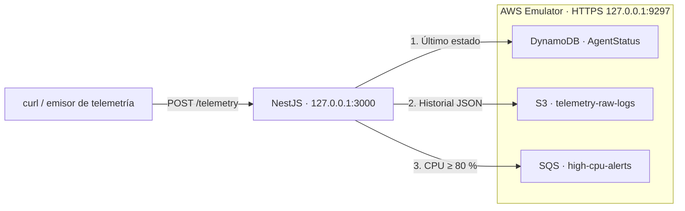

| Recurso | Nombre | Comportamiento |
| --- | --- | --- |
| Bucket S3 | `telemetry-raw-logs` | Un objeto por medición aceptada: `logs/<agentId>/<uuid>.json` |
| Tabla DynamoDB | `AgentStatus` | Clave de partición `agentId`, tipo string; cada escritura reemplaza el ítem del agente |
| Cola SQS | `high-cpu-alerts` | Un mensaje `HIGH_CPU_USAGE` por medición con `cpuUsage >= 80` |

El servicio escribe en orden: DynamoDB → S3 → SQS si corresponde. Responde cuando termina esas operaciones. El repositorio no incluye un agente recolector ni un consumidor de la cola; las mediciones de ejemplo se envían con `curl`.

## Entorno y resultados verificados

Registrados el **21 de noviembre de 2026** en [environment.txt](evidence/environment.txt):

| Componente | Versión registrada |
| --- | --- |
| Sistema | Linux Mint 22.3, x86_64 |
| Node.js / npm | 24.22.1 / 11.19.1 |
| AWS CLI | 2.36.29 |
| AWS Emulator | 1.0.551, publicación 2026.11.21 |
| TypeScript | 6.0.3 |
| Vitest | 4.1.12, visible en la salida de las pruebas |

El emulador identifica el commit `cc3a33fddf7ef0e48566ba31c217eb506b3c5f8f`. Estas son las versiones del laboratorio; no se afirma que sean las últimas disponibles.

| Comprobación | Resultado verificado | Alcance |
| --- | --- | --- |
| Pruebas unitarias | **2 aprobadas** | Delegación del controlador y respuesta de alerta; `AppService` simulado |
| Pruebas HTTP E2E | **3 aprobadas** | POST válido, CPU mayor que 100 y ausencia de `agentId`; `AppService` simulado |
| Compilación | **Correcta** | `npm run build` |
| Integración manual con el emulador | Capturas 07–12 | Telemetría normal/crítica, almacenamiento, alerta SQS y entrada inválida |
| Consultas al emulador durante la revisión | Correctas | Health HTTPS 200, cuenta STS local, bucket existente, tabla ACTIVE con clave `agentId` y URL de la cola |

Las pruebas y la compilación se ejecutaron de nuevo correctamente al revisar esta documentación. El flujo manual de POST, almacenamiento y mensajes está respaldado por las capturas existentes; **no se volvió a ejecutar** en esa revisión. Ninguna suite automatizada comprueba las llamadas al SDK ni la implementación del umbral de CPU contra el emulador.

## Estructura del repositorio

```text
.
├── README.md
├── backend/
│   ├── .env.example
│   ├── README.md
│   ├── src/                   # Controlador, servicio y DTO
│   ├── test/                  # Pruebas HTTP E2E
│   └── vitest.config*.ts
├── scripts/
│   ├── use-emulator.sh        # Cargar en cada terminal cliente/backend
│   └── init-aws.sh            # Crear/verificar los tres recursos locales
└── docs/
    ├── README.es.md
    ├── evidence/environment.txt
    └── images/               # 14 capturas originales
```

## Preparación en Linux Mint 22.3

Estos son pasos para reproducir el laboratorio. Durante la revisión documental no se reinstalaron paquetes ni se repitió `npm ci` desde cero. Se necesita Node.js y AWS CLI v2 instalados; utiliza las versiones registradas como referencia y consulta las instrucciones oficiales de [Node.js](https://nodejs.org/en/download) y de [instalación de AWS CLI](https://docs.aws.amazon.com/cli/latest/userguide/getting-started-install.html).

### 1. Instalar herramientas Linux y el emulador

Para el equipo x86_64/amd64 utilizado:

```bash
sudo apt-get update
sudo apt-get install -y git curl ca-certificates
mkdir -p ~/Downloads/aws-emulator-lab
cd ~/Downloads/aws-emulator-lab
curl -fSLo aws-emulator.deb \
  https://downloads.aws.com/aws-emulator/packages/aws-emulator/LTS/aws-emulator_1.0.551-1_amd64.deb
sudo apt-get install -y ./aws-emulator.deb
aws-emulator --version
node --version
npm --version
aws --version
```

La URL fija la versión del emulador registrada. AWS explica la [instalación Linux y verificación de la firma](https://docs.aws.amazon.com/emulator/latest/userguide/getting-started-linux.html) y las [URL para versiones específicas](https://docs.aws.amazon.com/emulator/latest/userguide/versioning.html). Revisa los cambios antes de actualizar y registra tus propios resultados si utilizas otra versión. Estos comandos instalan software; el backend se inicia después.

### 2. Iniciar el emulador — terminal A

```bash
aws-emulator
```

Mantén abierta esta terminal. El registro de inicio debe indicar `https://127.0.0.1:9297` y los archivos generados en `~/.aws/emulator/9297/`. Conserva la autenticación habilitada. Puedes iniciar con `--telemetry off` para desactivar la telemetría de uso/errores del propio emulador durante esa ejecución; consulta la [referencia del comando](https://docs.aws.amazon.com/emulator/latest/userguide/cli-reference.html). Esa telemetría es independiente de las mediciones enviadas a nuestra API.

### 3. Configurar la terminal y los recursos — terminal B

Clona el repositorio una sola vez (omite este paso si ya tienes una copia):

```bash
mkdir -p ~/Proyectos
git clone https://github.com/mickychog/aws-emulator-telemetry-lab.git ~/Proyectos/aws-emulator-telemetry-lab
```

Los comandos siguientes usan esa ruta; ajústala si guardaste el proyecto en otro directorio.

```bash
cd ~/Proyectos/aws-emulator-telemetry-lab
source scripts/use-emulator.sh
curl --fail --silent --show-error --cacert "$AWS_CA_BUNDLE" \
  https://127.0.0.1:9297/__admin/health
aws sts get-caller-identity
bash scripts/init-aws.sh
```

Se espera HTTP 200 (`ok`), cuenta STS **`000000000000`** y los tres recursos disponibles. Si aparece otra cuenta, detente y revisa la configuración antes de continuar.

`use-emulator.sh` exporta estas variables en la terminal actual:

| Variable | Valor/propósito |
| --- | --- |
| `AWS_ENDPOINT_URL` | `https://127.0.0.1:9297` |
| `AWS_SHARED_CREDENTIALS_FILE` | `$HOME/.aws/emulator/9297/emulator_credentials` |
| `AWS_CONFIG_FILE` | `$HOME/.aws/emulator/9297/config` |
| `AWS_CA_BUNDLE`, `NODE_EXTRA_CA_CERTS` | `$HOME/.aws/emulator/9297/ca.pem`; confianza TLS para CLI y Node |
| `AWS_REGION`, `AWS_DEFAULT_REGION` | `us-east-1` |
| `AWS_EC2_METADATA_DISABLED` | `true` |
| `AWS_DISABLE_HOST_PREFIX_INJECTION` | `true` para las operaciones compatibles de la CLI |
| `AWS_PAGER` | Vacío; evita el paginador |

Elimina las variables heredadas `AWS_ACCESS_KEY_ID`, `AWS_SECRET_ACCESS_KEY`, `AWS_SESSION_TOKEN` y `AWS_PROFILE`. Carga este script con **`source`**, para conservar las variables en la terminal. Repítelo en cada terminal que ejecute AWS CLI o el backend. Las credenciales pertenecen a tu propia instancia; no copies las de otra persona. Consulta la [configuración oficial de endpoint y certificados](https://docs.aws.amazon.com/emulator/latest/userguide/point-sdk-to-emulator.html).

`init-aws.sh` rechaza otro endpoint o cuenta STS. Reutiliza un bucket existente, solicita la cola por nombre, crea la tabla si falta con `PAY_PER_REQUEST` y comprueba estado ACTIVE y primera clave `agentId`. Puedes repetirlo para la configuración esperada, pero no corrige diferencias arbitrarias en el esquema de recursos existentes.

### 4. Instalar e iniciar el backend — terminal B

```bash
cd ~/Proyectos/aws-emulator-telemetry-lab
source scripts/use-emulator.sh
cd backend
npm ci
# Crear el archivo local únicamente si todavía no existe:
if [ ! -f .env ]; then cp .env.example .env; fi
npm run start:dev
```

El `.env` local debe contener:

```dotenv
S3_BUCKET_NAME=telemetry-raw-logs
DYNAMODB_TABLE_NAME=AgentStatus
SQS_QUEUE_NAME=high-cpu-alerts
```

NestJS lee `.env` desde el directorio de trabajo del backend. La API escucha explícitamente en **`http://127.0.0.1:3000`**; el código actual no lee `PORT`. El endpoint AWS usa HTTPS y la API local usa HTTP. El servicio impide arrancar si `AWS_ENDPOINT_URL` no coincide exactamente con el endpoint local. S3 utiliza `forcePathStyle: true`; SQS utiliza `useQueueUrlAsEndpoint: false` para mantener el endpoint configurado.

## Probar la API — terminal C

```bash
cd ~/Proyectos/aws-emulator-telemetry-lab
source scripts/use-emulator.sh
```

### Telemetría normal

```bash
curl -i -sS -X POST http://127.0.0.1:3000/telemetry \
  -H 'Content-Type: application/json' \
  -d '{"agentId":"node-01","hostname":"linux-mint-lab","cpuUsage":35.5,"memoryUsage":48.2}'
```

Se espera **201 Created** y `alertTriggered: false`. La siguiente estructura es ilustrativa: el timestamp y el UUID se generan en cada solicitud.

```json
{
  "status": "processed",
  "agentId": "node-01",
  "timestamp": "<timestamp ISO generado>",
  "s3Key": "logs/node-01/<UUID generado>.json",
  "alertTriggered": false
}
```

### CPU alta

```bash
curl -i -sS -X POST http://127.0.0.1:3000/telemetry \
  -H 'Content-Type: application/json' \
  -d '{"agentId":"node-02","hostname":"server-test","cpuUsage":92.5,"memoryUsage":76.3}'
```

Se espera **201**, `alertTriggered: true`, estado actualizado en DynamoDB, un objeto nuevo en S3 y un mensaje JSON en SQS con `type`, `agentId`, `cpuUsage` y `timestamp`. El tipo es `HIGH_CPU_USAGE`. La memoria se almacena, pero no genera alertas. Repetir una solicitud con CPU alta genera alertas adicionales.

### Datos inválidos

```bash
curl -i -sS -X POST http://127.0.0.1:3000/telemetry \
  -H 'Content-Type: application/json' \
  -d '{"agentId":"node-03","hostname":"invalid-test","cpuUsage":150,"memoryUsage":40}'
```

Se espera **400 Bad Request**. Los usos de CPU y memoria deben ser números JSON entre 0 y 100; `agentId` y `hostname`, strings no vacíos. Los cuatro campos son obligatorios. El `ValidationPipe` global rechaza propiedades adicionales (`whitelist`, `forbidNonWhitelisted`, `transform`). La validación rechaza esta solicitud antes de llamar al servicio. No existe la ruta de ejemplo `GET /`.

### Consultar almacenamiento y alertas locales

Utiliza una terminal configurada con `source scripts/use-emulator.sh` desde la raíz:

```bash
aws dynamodb get-item --table-name AgentStatus \
  --key '{"agentId":{"S":"node-01"}}'
aws s3 ls s3://telemetry-raw-logs/logs/node-01/
aws dynamodb get-item --table-name AgentStatus \
  --key '{"agentId":{"S":"node-02"}}'
aws s3 ls s3://telemetry-raw-logs/logs/node-02/
QUEUE_URL=$(aws sqs get-queue-url --queue-name high-cpu-alerts \
  --query QueueUrl --output text)
aws sqs receive-message --endpoint-url "$AWS_ENDPOINT_URL" \
  --queue-url "$QUEUE_URL" --max-number-of-messages 10 --wait-time-seconds 2
aws sqs get-queue-attributes --endpoint-url "$AWS_ENDPOINT_URL" \
  --queue-url "$QUEUE_URL" \
  --attribute-names ApproximateNumberOfMessages ApproximateNumberOfMessagesNotVisible
```

La URL devuelta puede contener `sqs.us-east-1.amazonaws.com/000000000000/...`; conserva el endpoint local configurado. El backend impide usar la URL de la cola como endpoint de transporte. Recibir un mensaje modifica temporalmente su visibilidad; no lo elimina. Un contador de mensajes visibles en cero después de recibir no demuestra que la cola esté vacía ni que el mensaje se haya borrado. No hay consumidor ni confirmación automática en este proyecto.

## Ejecutar las comprobaciones automatizadas

Desde `backend/`, con las dependencias instaladas (estas pruebas usan un servicio simulado y no necesitan el emulador):

```bash
npx vitest run --config vitest.config.ts
npx vitest run --config vitest.config.e2e.ts
npm run build
```

También puedes usar `npm test` y `npm run test:e2e`. Se esperan **2 unitarias + 3 HTTP E2E**. La compilación escribe en `dist/`. Estas cinco pruebas no acreditan cobertura completa, manejo de fallos del servicio, comportamiento en el límite de CPU, rendimiento ni integración con AWS real.

## Galería de evidencias

Las **14 capturas originales se muestran directamente desde este repositorio**. Documentan la ejecución registrada del laboratorio, no una nueva ejecución de la integración. La numeración salta el 13. La alternativa `04-emulated-account1.png` está excluida de Git.

### Entorno, emulador, identidad y recursos (01–06)

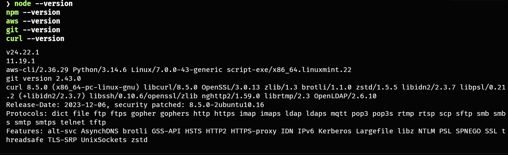

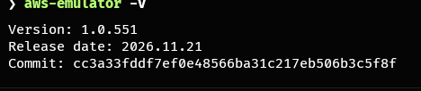

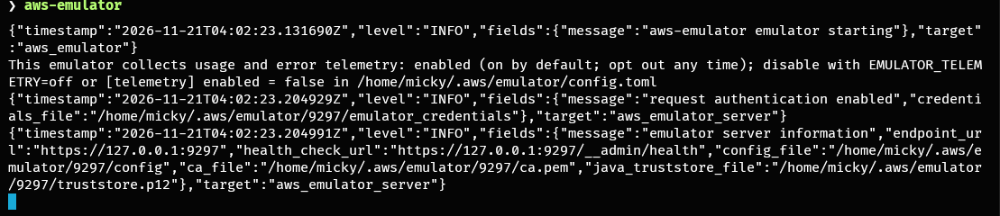

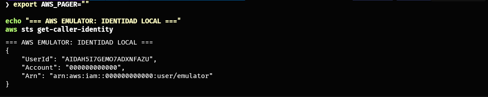

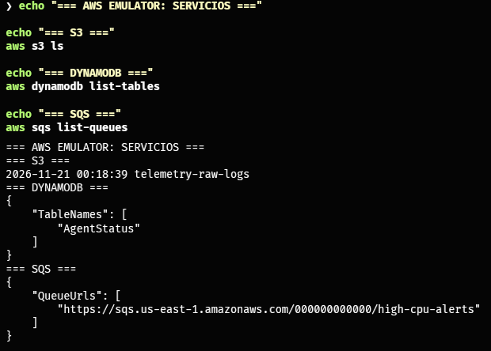

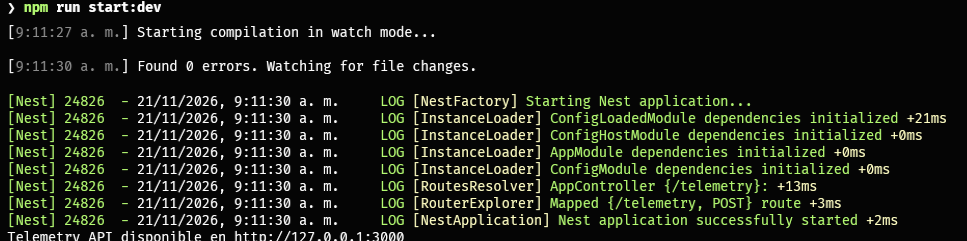

### Comprobaciones manuales de API, almacenamiento, alertas y validación (07–12)

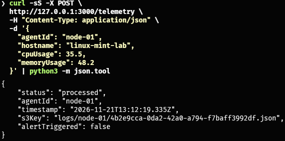

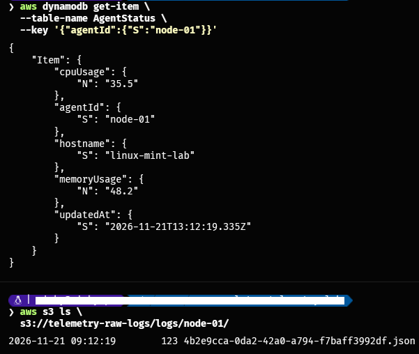

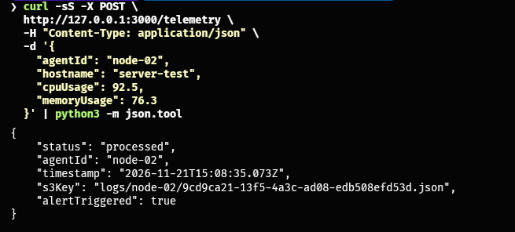

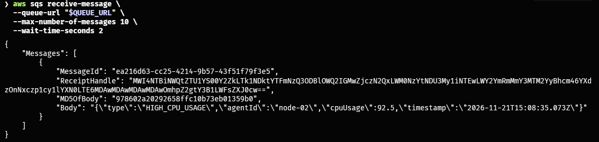

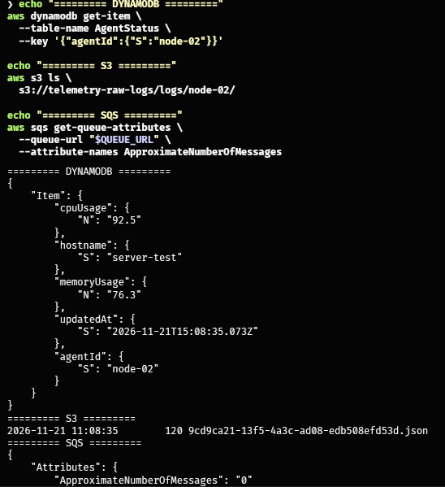

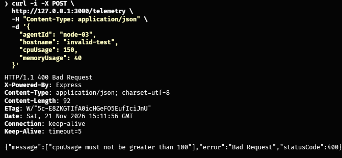

### Pruebas automatizadas (14–15)

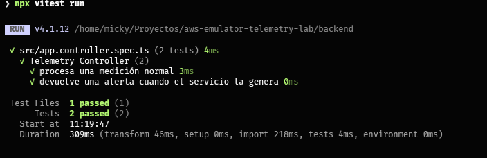

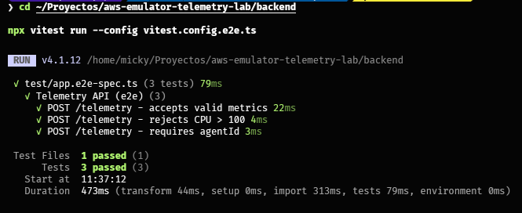

## Seguridad y limitaciones

- Mantén el emulador y la API en loopback. Conserva la autenticación y confía en la CA generada; evita `--no-verify-ssl`, `curl -k` y `NODE_TLS_REJECT_UNAUTHORIZED=0`.
- Usa solo credenciales locales. `.env`, `.aws/`, certificados, `node_modules/`, `dist/` y cobertura están ignorados. Las exclusiones no retiran archivos ya rastreados ni ocultan secretos dentro de imágenes. Las capturas contienen rutas locales e identificadores emulados; revísalas antes de publicar.
- Las comprobaciones de endpoint y cuenta reducen el riesgo de usar AWS accidentalmente; no constituyen una barrera de seguridad. Revisa las variables y configuraciones que puedan cambiar el destino de la CLI.
- La emulación no acredita compatibilidad de producción ni corrección de políticas IAM. Usa una cuenta/región para este laboratorio; consulta las [limitaciones oficiales](https://docs.aws.amazon.com/emulator/latest/userguide/what-is-service.html#what-is-service-limitations).
- El backend no tiene autenticación, autorización, límites de solicitudes, reintentos durables ni claves de idempotencia. Las escrituras no son atómicas: un fallo puede dejar operaciones anteriores guardadas y un reintento puede duplicar objetos S3 o mensajes SQS.
- Determinados mensajes de error de conexión se traducen a HTTP 503; los demás errores de procesamiento, a HTTP 500. Estas rutas de fallo no están cubiertas por las pruebas actuales.
- No incluye recolector de métricas, dashboard, consumidor de alertas, configuración de despliegue ni CI. Aunque `@nestjs/observe` figura como dependencia, `AppModule` no registra `ObserveModule`; no se afirma que el laboratorio tenga esa instrumentación.
- Los recursos del emulador viven en memoria y se pierden al detenerlo. Después de reiniciarlo, inicializa los recursos de nuevo y reinicia el backend para cargar el certificado nuevo. Consulta el [ciclo de vida del emulador](https://docs.aws.amazon.com/emulator/latest/userguide/getting-started-linux.html).

## Problemas frecuentes y cierre

| Síntoma | Acción |
| --- | --- |
| Error de seguridad del endpoint al arrancar | Carga `scripts/use-emulator.sh` en la terminal que inicia NestJS |
| Error de certificado | Comprueba el emulador, carga el script y reinicia Node para que lea `NODE_EXTRA_CA_CERTS` |
| Faltan credenciales o acceso denegado | Comprueba los archivos de la ejecución actual; carga el script para eliminar credenciales de nube heredadas |
| Falta bucket, tabla o cola | Ejecuta `bash scripts/init-aws.sh` desde la raíz y con el entorno cargado |
| Faltan valores del `.env` | Crea `backend/.env` desde el ejemplo e inicia desde `backend/` |
| Puerto 9297/3000 ocupado | Revisa `ss -ltnp`; usa el proceso previsto o detén tu instancia anterior. Cambiar el puerto del emulador requiere modificar código y scripts porque este laboratorio fija 9297 |
| SQS no devuelve mensajes | Envía CPU alta y revisa mensajes visibles/en vuelo y recepciones anteriores |

Detén NestJS y luego el emulador con Ctrl+C en sus terminales. Abre una terminal nueva antes de volver a trabajar con AWS real para no heredar la configuración del laboratorio.

## Contribuir y publicar actualizaciones

Desde la raíz, revisa y prepara los documentos explícitamente:

```bash
git add README.md docs/README.es.md backend/README.md
git diff --check
git diff --cached --check
git status --short
git diff --cached --stat
git diff --cached --name-only
```

Revisa el código, configuración e imágenes preparados y comprueba que no hay archivos privados. El repositorio principal es [mickychog/aws-emulator-telemetry-lab](https://github.com/mickychog/aws-emulator-telemetry-lab), con rama predeterminada `main`.

Cuando termines tus cambios documentales, crea el commit:

```bash
git commit -m "docs: document AWS Emulator telemetry lab in English and Spanish"
```

Al clonar, `origin` ya queda configurado. Inspecciona `git remote -v` antes de subir cambios. Quien tenga permisos de escritura puede publicar con `git push -u origin main`; los demás colaboradores deben usar su propio fork y una solicitud de cambios. La copia local original usa el remoto SSH `git@github.com:mickychog/aws-emulator-telemetry-lab.git`. Después comprueba en GitHub los enlaces entre idiomas y la visualización de las imágenes.

Todavía no hay un archivo de licencia del proyecto y `backend/package.json` declara `UNLICENSED`. Elige una licencia antes de ofrecer derechos de reutilización. Para AWS Builder Center o DEV Community, enlaza el repositorio publicado, identifica las versiones probadas y distingue las evidencias manuales de las pruebas automatizadas con simulación. Publicar el artículo es un paso separado.
